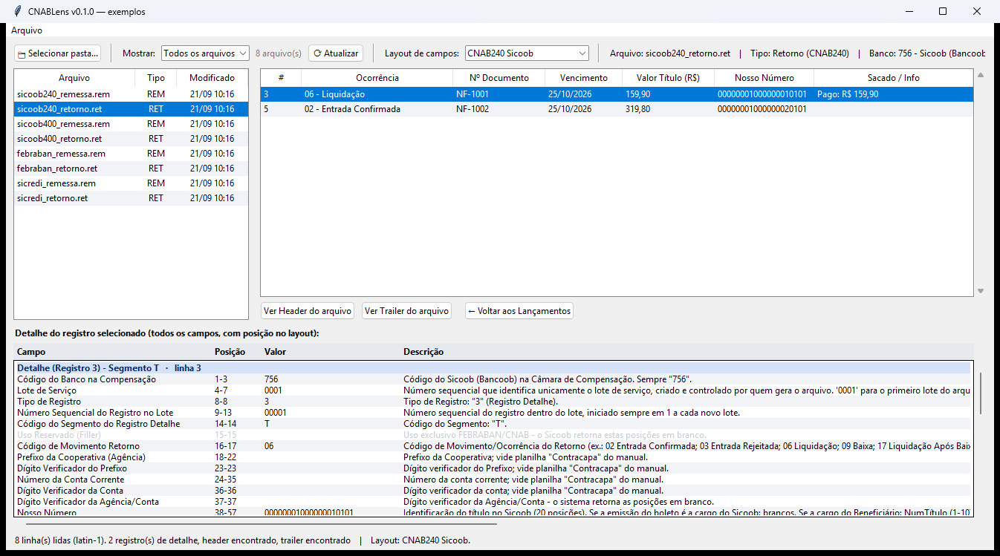
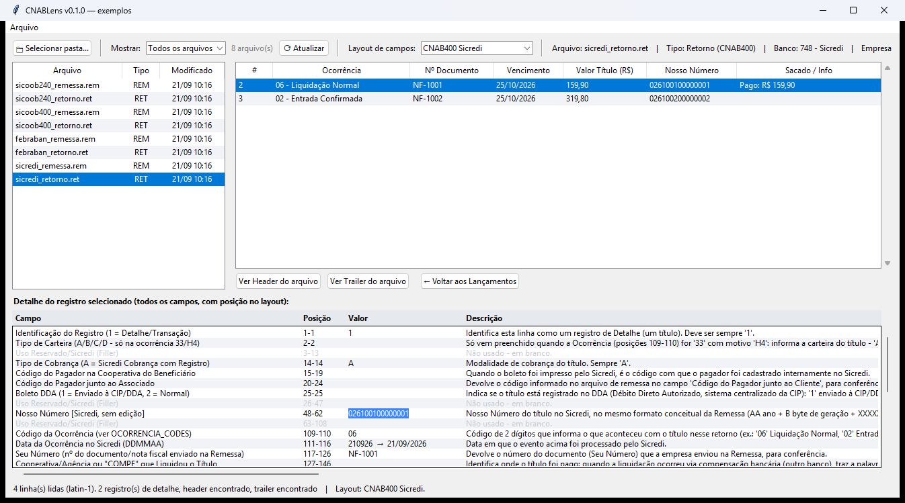
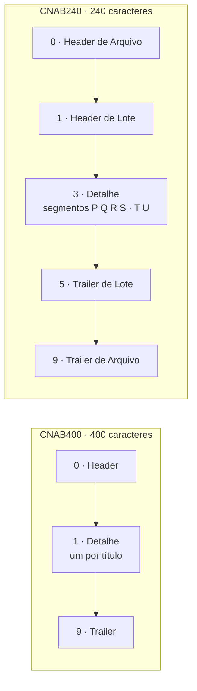
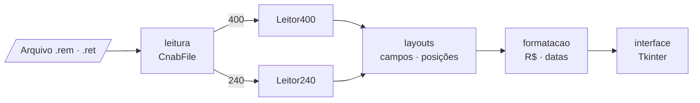

<!-- markdownlint-disable MD033 MD041 -->
<div align="center">

# 🔍 CNABLens

**Uma lente para arquivos CNAB.**

Abra um arquivo de **remessa** ou **retorno** de cobrança bancária (CNAB400 ou CNAB240) e veja cada lançamento<br>
com **o nome correto de cada campo**, a posição no layout, o valor e a descrição oficial.<br>
Para **Windows e Linux**, 100% no seu computador, sem instalação.

<br>

[](https://github.com/BrunodosSantosVaz/cnab-lens/releases/latest)
[](https://github.com/BrunodosSantosVaz/cnab-lens/releases)
[](https://github.com/BrunodosSantosVaz/cnab-lens/actions/workflows/ci.yml)
[](https://github.com/BrunodosSantosVaz/cnab-lens/actions/workflows/codeql.yml)
[](LICENSE)
<br>
[](#-download-e-instalação)
[](packaging/linux/README.md)
[](pyproject.toml)
[](https://docs.astral.sh/ruff/)
[](#-segurança-e-privacidade)

<br>

<a href="https://github.com/BrunodosSantosVaz/cnab-lens/releases/latest"></a>
<a href="#-como-usar"></a>
<a href="#-layouts-suportados"></a>
<a href="https://github.com/BrunodosSantosVaz/cnab-lens/discussions"></a>

<br><br>



</div>

<br>

<details>
<summary><b>Sumário</b></summary>

- [Para que serve](#-para-que-serve)
- [Recursos](#-recursos)
- [Download e instalação](#-download-e-instalação)
- [Como usar](#-como-usar)
- [Layouts suportados](#-layouts-suportados)
- [Arquivos de exemplo](#-arquivos-de-exemplo)
- [Guia rápido de CNAB](#-guia-rápido-de-cnab)
- [Para desenvolvedores](#-para-desenvolvedores)
- [Versões e releases](#-versões-e-releases)
- [Segurança e privacidade](#-segurança-e-privacidade)
- [Limitações conhecidas](#-limitações-conhecidas)
- [Contribuindo](#-contribuindo)
- [Licença, avisos e fontes](#-licença-avisos-e-fontes)

</details>

## 🎯 Para que serve

Arquivos CNAB são texto de largura fixa: cada linha tem 400 (ou 240) caracteres e o significado de cada trecho depende da posição e do banco. Abrir um deles no Bloco de Notas mostra só uma parede de números. O CNABLens faz a leitura por você.

<table>
<tr>
<td width="25%" valign="top">

### ✅ Conferir um retorno
Quais boletos foram liquidados, com que valor, em que data e com qual ocorrência.

</td>
<td width="25%" valign="top">

### 📤 Conferir uma remessa
Valores, vencimentos, pagador e instruções, antes de enviar ao banco.

</td>
<td width="25%" valign="top">

### 🐞 Depurar integração
Em qual posição está um campo e o que ele deveria conter, sem abrir o manual.

</td>
<td width="25%" valign="top">

### 📘 Estudar o layout
Cada campo traz a descrição transcrita do manual oficial do banco.

</td>
</tr>
</table>

## ✨ Recursos

| | Recurso | |
|:-:|---|---|
| 📄 | **CNAB400 e CNAB240** | Remessa e retorno, com detecção automática do formato |
| 🏦 | **Layouts por banco** | FEBRABAN, Sicredi, Sicoob e Santander, escolhidos pelo código no Header e trocáveis na hora |
| 📁 | **Navegação por pasta** | Filtro por extensão e tipo de cada arquivo (REM/RET) na lista |
| 🔎 | **Todos os campos** | Nome, posição (início-fim), valor e descrição. `R$ 1.234,56` e `25/10/2026`, sempre com o valor bruto |
| 🧩 | **Títulos CNAB240 por segmento** | P+Q+R na remessa, T+U no retorno. Header/Trailer de arquivo e de lote em um clique |
| 📋 | **Copiar qualquer valor** | Arraste para selecionar, <kbd>Ctrl</kbd>+<kbd>C</kbd> para copiar |
| 🗂️ | **Tabelas de códigos** | Ocorrências, comandos, bancos e espécies de título traduzidos |
| 🧠 | **Leitura tolerante** | Datas `DDMMAA`, `AAAAMMDD` ou `DDMMAAAA`, formatadas só quando válidas. Campos reservados esmaecidos |
| 🔒 | **Somente leitura** | O programa nunca altera nem grava nenhum arquivo |

## 📦 Download e instalação

**Não precisa instalar nada** (nem Python). Os executáveis ficam em [**Releases**](https://github.com/BrunodosSantosVaz/cnab-lens/releases/latest). A marcada **Latest** é a versão de produção.

| Sistema | Arquivo | Hash |
|---|---|---|
|  | `CNABLens-vX.Y.Z-windows-x64.exe` | `SHA256SUMS.txt` |
|  | `CNABLens-vX.Y.Z-linux-x64` (glibc 2.28+) | `SHA256SUMS-linux.txt` |

<details open>
<summary><b>Windows</b></summary>

1. Baixe o `.exe` da versão mais recente.
2. *(Recomendado)* confira o hash e compare com o `SHA256SUMS.txt` da mesma release:

   ```powershell
   Get-FileHash .\CNABLens-vX.Y.Z-windows-x64.exe -Algorithm SHA256
   ```

3. Dê dois cliques no `.exe`.

</details>

<details>
<summary><b>Linux</b></summary>

```bash
sha256sum -c SHA256SUMS-linux.txt
chmod +x CNABLens-vX.Y.Z-linux-x64
./CNABLens-vX.Y.Z-linux-x64
```

Roda em Ubuntu 20.04+, Debian 10+, Fedora, Mint, Manjaro e outras distros com glibc 2.28+. Python e Tk vão dentro do executável. Detalhes em [`packaging/linux/README.md`](packaging/linux/README.md).

</details>

> [!WARNING]
> O executável **não é assinado digitalmente**, então o SmartScreen pode mostrar "O Windows protegeu seu computador". Clique em **Mais informações → Executar assim mesmo**. Alguns antivírus marcam executáveis do PyInstaller como suspeitos (falso positivo comum). O código é aberto para você auditar e compilar o seu próprio.

*Verificação avançada:* os `.exe` do CI têm atestado de procedência: `gh attestation verify CNABLens-vX.Y.Z-windows-x64.exe --repo BrunodosSantosVaz/cnab-lens`.

## 🖱️ Como usar

1. Clique em **Selecionar pasta...** (<kbd>Ctrl</kbd>+<kbd>O</kbd>) e escolha a pasta com os arquivos CNAB.
2. Clique em um arquivo da lista. O topo mostra tipo, formato, banco, empresa, data de geração e número de lançamentos.
3. A grade lista cada título com ocorrência, documento, vencimento, valor, nosso número e pagador (ou valor pago, no retorno).
4. Clique em um lançamento: o painel de baixo mostra **todos os campos** dele.
5. Use **Ver Header do arquivo** e **Ver Trailer do arquivo** para os registros de abertura e fechamento.
6. Troque o layout em **Layout de campos**, se o escolhido automaticamente não for o que você quer.

### Copiando valores

| Ação | Resultado |
|---|---|
| Arrastar o mouse no painel de campos | Seleciona o trecho |
| Duplo clique numa célula | Seleciona a célula inteira |
| <kbd>Ctrl</kbd>+<kbd>C</kbd> | Copia a seleção |
| <kbd>Ctrl</kbd>+<kbd>A</kbd> | Seleciona todo o painel |
| <kbd>Ctrl</kbd>+<kbd>C</kbd> na grade | Copia a linha com colunas separadas por tab, pronta para planilha |

<p align="center">
  
</p>

## 🏦 Layouts suportados

| Layout | Linha | Banco | Automático | Testado com arquivo real |
|---|:-:|---|:-:|:-:|
| **CNAB400 FEBRABAN** | 400 | Genérico (Itaú, BB, Bradesco, Caixa e outros) | ✅ bancos sem layout próprio | — |
| **CNAB400 Sicredi** | 400 | `748` | ✅ | ✅ retornos |
| **CNAB400 Sicoob** | 400 | `756` | ✅ | — |
| **CNAB400 Santander** | 400 | `033` (e `353` legado) | ✅ | — |
| **CNAB240 Sicoob** | 240 | `756` | ✅ e padrão para 240 sem layout próprio | — |
| **CNAB240 Santander** | 240 | `033` | ✅ | — |

<details>
<summary><b>Notas por layout</b></summary>

- **FEBRABAN**: usado por muitos bancos com pequenas variações. Se o seu banco divergir, o valor bruto continua correto e só o rótulo do campo pode diferir.
- **Sicredi**: layout próprio (Tipo de Cobrança, Boleto Híbrido/Pix, Nosso Número `AA/BXXXXX-D` separado em partes, Beneficiário Final). A data do Header é `AAAAMMDD`.
- **Sicoob 400**: o Detalhe tipo 1 é o único registro de título. O Trailer é diferente na remessa e no retorno, e o retorno traz só o CPF/CNPJ do pagador.
- **Sicoob 240**: Header/Trailer de arquivo e de lote, segmentos P, Q, R, S (remessa) e T, U (retorno), com Nosso Número de 20 posições.
- **Santander 400**: além do Detalhe (tipo `1`), descreve o registro `8` (QR Code/PIX), as mensagens `2` e `4` a `7` na remessa, e o registro `2` (QR Code/PIX) no retorno, agrupados sob o boleto.
- **Santander 240**: segmentos P, Q, R, S, T e U, Nosso Número de 13 posições e segmento **Y** (`Y-03`, `Y-53`, `Y-04`) identificado pelas posições 18-19.

</details>

## 🧪 Arquivos de exemplo

A pasta [`exemplos/`](exemplos/) traz um par remessa/retorno **100% fictício** para cada layout.

| Arquivos | Layout |
|---|---|
| `febraban_remessa.rem` · `febraban_retorno.ret` | CNAB400 FEBRABAN |
| `sicredi_remessa.rem` · `sicredi_retorno.ret` | CNAB400 Sicredi |
| `sicoob400_remessa.rem` · `sicoob400_retorno.ret` | CNAB400 Sicoob |
| `sicoob240_remessa.rem` · `sicoob240_retorno.ret` | CNAB240 Sicoob |
| `santander400_remessa.rem` · `santander400_retorno.ret` | CNAB400 Santander (com QR Code/PIX) |
| `santander240_remessa.rem` · `santander240_retorno.ret` | CNAB240 Santander (com segmento Y-03) |

Para regenerá-los: `python scripts/gerar_exemplos.py`.

## 📚 Guia rápido de CNAB

- **Remessa**: arquivo que a **empresa envia ao banco** com os títulos a cobrar ou instruções sobre eles.
- **Retorno**: arquivo que o **banco devolve** contando o que aconteceu (registrado, liquidado, baixado, rejeitado...).
- Valores vêm sem vírgula (`0000015990` = R$ 159,90) e datas sem separador.



No CNAB240, o tipo do registro fica na posição 8 e a letra do segmento na posição 14.

## 🛠️ Para desenvolvedores

**Pré-requisitos:** Python 3.10+ com Tkinter (no Linux, `python3-tk`). Nenhuma biblioteca externa é necessária para rodar.

```bash
git clone https://github.com/BrunodosSantosVaz/cnab-lens.git
cd cnab-lens
pip install -e .
python -m cnablens
```

| Comando | O que faz |
|---|---|
| `python -m cnablens` | Abre o programa |
| `python -m unittest discover -s tests -v` | Testes de layouts, leitura, formatação, interface e equivalência |
| `uvx ruff check .` | Estilo e qualidade |
| `python -m cnablens.layouts` | Confere as posições dos layouts (a partir de `src/`) |
| `python packaging\windows\build_exe.py` | Compila o `.exe` em `build-local/` |
| `bash packaging/linux/compilar.sh` | Compila o executável Linux num container glibc 2.28 |

### Como o programa funciona



1. **Leitura** (`cnablens.leitura`): o `CnabFile` detecta o tamanho da linha e entrega ao `Leitor400` ou `Leitor240` (padrão *Strategy*), que classifica os registros e lê o Header.
2. **Layout** (`cnablens.layouts`): diz quais campos, nomes e posições aplicar. Trocar o layout só reaplica os nomes, sem reler o disco.
3. **Formatação** (`cnablens.formatacao`): valores em R$ e datas, sempre com o valor bruto ao lado.
4. **Interface** (`cnablens.interface`): só apresenta. Leitura e formatação funcionam sem Tkinter.

<details>
<summary><b>Estrutura do repositório</b></summary>

```
cnab-lens/
├── src/cnablens/              Código-fonte (só biblioteca padrão)
│   ├── __main__.py            Ponto de entrada (python -m cnablens)
│   ├── version.py             Versão do programa
│   ├── formatacao.py          Valores em R$, datas e valor de tela
│   ├── leitura/               CnabFile, Leitor400, Leitor240, registros e pasta
│   ├── layouts/               base, bancos e um módulo por layout
│   └── interface/             Janela, painel de campos, lista de arquivos e estilo
├── tests/                     Testes automatizados (unittest)
├── packaging/                 Compiladores Windows e Linux
├── scripts/                   gerar_exemplos.py e configuração do GitHub
├── exemplos/                  Arquivos CNAB fictícios
└── docs/                      Processo de desenvolvimento e imagens
```

</details>

<details>
<summary><b>Adicionando um novo layout (outro banco)</b></summary>

1. Crie o módulo de dados em `src/cnablens/layouts/` (ex.: `itau400.py`) no estilo de `sicredi400.py`: tuplas `(nome do campo, início, fim, descrição)` cobrindo as posições 1–400 (ou 1–240) sem lacunas, mais as tabelas de ocorrência.
2. Registre em `src/cnablens/layouts/__init__.py`: um `Layout400` (ou `Layout240`) em `LAYOUTS`, a chave em `LAYOUT_ORDER` e, para a escolha automática, em `AUTO_LAYOUT_BY_BANK`.
3. Confira as posições com `python -m cnablens.layouts`.
4. Use os nomes de campo do resumo da grade: `Nosso Número`, `Número do Documento`, `Data de Vencimento`, `Valor Nominal`, `Código da Ocorrência`, `Nome do Pagador`, `Valor Pago`.
5. Gere um exemplo fictício em `scripts/gerar_exemplos.py` e regere o retrato de equivalência com `python tests/test_equivalencia.py --gerar`.

</details>

## 🏷️ Versões e releases

[Versionamento semântico](https://semver.org/lang/pt-BR/) com cada versão no [CHANGELOG](CHANGELOG.md). **A versão diz o ambiente:**

| Ambiente | Como reconhecer |
|---|---|
|  | Release **Latest**, versão `X.Y.Z` |
|  | **Pre-release** `X.Y.Z-rc.N` |

Aprovada a candidata, os **mesmos binários** são promovidos a produção. O ciclo completo está em [docs/processo.md](docs/processo.md).

| Versão | Destaque |
|---|---|
| **0.4.0** | Santander 400 e 240 detalhados, rolagem e menu Sobre |
| **0.3.0** | Pacote `src/cnablens`, layouts orientados a objeto, leitores por formato e Ruff |
| **0.2.0** | Layouts Santander CNAB400 e CNAB240, com QR Code/PIX e segmento Y |
| **0.1.0** | Primeira versão: FEBRABAN, Sicredi e Sicoob |

## 🔐 Segurança e privacidade

- **Tudo local.** Sem rede, sem telemetria, sem gravar ou alterar arquivos.
- **Executável não assinado.** Confira o SHA-256 ou compile a partir do código-fonte.
- **Vulnerabilidade?** Use o [relato privado](https://github.com/BrunodosSantosVaz/cnab-lens/security/advisories/new). Veja a [política de segurança](SECURITY.md).

> [!CAUTION]
> Arquivos CNAB reais contêm nomes, CPF/CNPJ, endereços e valores de terceiros, protegidos pela LGPD. **Nunca anexe arquivos reais em issues, pull requests ou fóruns.** Use dados fictícios ou informe só as posições e os valores envolvidos.

## ⚠️ Limitações conhecidas

<details>
<summary><b>Ver limitações</b></summary>

- Só o **Sicredi** foi validado com arquivos reais. **Sicoob**, **Santander** e **FEBRABAN** foram testados com arquivos sintéticos.
- **Santander**: os manuais têm pequenas inconsistências (por exemplo, o banco aparece como `33` no Header de Arquivo do CNAB240). O programa segue as posições. Os manuais não trazem histórico de revisões e o site do Santander não permite download automático, então uma versão nova precisa ser conferida à mão.
- **Sicoob 400, retorno**: o CPF/CNPJ do pagador (posições 343–356) tem baixa confiança, porque a planilha oficial escreve 343–357.
- **Sicoob 240**: a planilha mais recente é de 2019. As tabelas de motivos de ocorrência e rejeição vêm de fonte secundária. Os segmentos Y e W aparecem como "Conteúdo do Registro (não mapeado neste layout)".
- **CNAB400** cobre só o Detalhe obrigatório (tipo `1`), exceto no Santander, que descreve os registros opcionais.
- **Sicredi**: a "Tabela de Motivos" do retorno não é decodificada.
- O programa lê um arquivo por vez e **interpreta**, não **audita**: não valida dígito verificador, soma do trailer etc.
- **Linux**: só x86_64 com glibc 2.28+. A interface usa X11 (em Wayland, pelo XWayland) e as fontes podem ficar um pouco diferentes das do Windows.

</details>

## 🤝 Contribuindo

Contribuições são bem-vindas, principalmente: **conferir um layout com arquivo real** (sem dados pessoais), **novos bancos e layouts** e correções de rótulos e descrições.

| Quero… | Vá para |
|---|---|
| Tirar uma dúvida de uso | [Discussions → Q&A](https://github.com/BrunodosSantosVaz/cnab-lens/discussions) |
| Sugerir uma ideia ou um banco novo | [Discussions → Ideas](https://github.com/BrunodosSantosVaz/cnab-lens/discussions) |
| Relatar um bug | [Nova issue → Bug](https://github.com/BrunodosSantosVaz/cnab-lens/issues/new/choose) |
| Avisar de um campo que não bate com o manual | [Nova issue → Layout ou banco](https://github.com/BrunodosSantosVaz/cnab-lens/issues/new/choose) |
| Alterar código, documentação ou testes | Pull request de um fork para a `develop`, ligado a uma issue |
| Relatar uma vulnerabilidade | [Relato privado](https://github.com/BrunodosSantosVaz/cnab-lens/security/advisories/new) |

1. Tenha uma issue e crie a branch a partir da `develop`: `feature/<n>-<slug>` ou `bugfix/<n>-<slug>`.
2. Programe com testes. Para bug, escreva primeiro o teste que falha.
3. Abra o PR para a `develop` com `Refs #<n>`. Os checks `check` e `regras` precisam passar.

O passo a passo está em [CONTRIBUTING.md](CONTRIBUTING.md), o processo em [docs/processo.md](docs/processo.md) e a conduta no [Código de Conduta](CODE_OF_CONDUCT.md).

## 📄 Licença, avisos e fontes

Distribuído sob a **[Licença MIT](LICENSE)**.

**Aviso.** Projeto independente, **sem vínculo com nenhum banco, cooperativa ou com a FEBRABAN**. Os nomes dos bancos são marcas de seus titulares e aparecem apenas para identificar os layouts. Confirme sempre valores e situação de títulos com o seu banco.

<details>
<summary><b>Fontes dos layouts</b></summary>

| Layout | Fonte |
|---|---|
| CNAB400 FEBRABAN | [Itaú, Cobrança Bancária CNAB 400 (jan/2017)](https://download.itau.com.br/bankline/layout_cobranca_400bytes_cnab_itau.pdf), conferido com o [retorno CNAB 400 do Banco do Brasil](https://www.bb.com.br/docs/pub/emp/empl/dwn/Doc2628CBR643Pos7.pdf) |
| CNAB400 Sicredi | [Manual CNAB 400 Cobrança, versão 2.4 (out/2022)](https://www.sicredi.com.br/media/produtos/filer_public/2022/09/26/manual_cnab_400_2-4_260922.pdf) |
| CNAB400 Sicoob | [Planilha oficial `Layout_Cobranca_CNAB400.xls`](https://www.sicoob.com.br/documents/20128/263767178/Layout_Cobranca_CNAB400.xls/675009c2-3ed6-3156-ea46-54cf78088652?version=1.0&t=1747656841831&download=true) |
| CNAB240 Sicoob | [Planilha oficial de layouts CNAB240](https://www.sicoob.com.br/documents/3068856/0/layout-cnab-240.xls/5bfadf52-4278-3d28-0b69-b09b467aad45) (arquivo 081, lote 040/044) |
| CNAB400 Santander | Manual "Layout Cobrança H7800 - CNAB 353/400 posições", versão 2.37 (fev/2026), na [página de layouts do Santander](https://www.santander.com.br/layout-de-arquivos) |
| CNAB240 Santander | Manual "Layout Cobrança H7815 - CNAB 240 posições", versão 8.5 (fev/2026), na [página de layouts do Santander](https://www.santander.com.br/layout-de-arquivos) |

Conferências cruzadas (sem cópia de código): [brcobranca](https://github.com/kivanio/brcobranca), [laravel-boleto](https://github.com/eduardokum/laravel-boleto), [cnab-layouts](https://github.com/glauberportella/cnab-layouts) e [ACBr](https://github.com/frones/ACBr).

</details>

O executável empacota o **Python** (licença PSF), o **Tcl/Tk** (licença BSD) e é gerado com o **PyInstaller** (GPLv2 com exceção para o executável gerado).

<div align="center">

<br>

<sub>Desenvolvido por <a href="https://github.com/BrunodosSantosVaz">Bruno dos Santos Vaz</a></sub>

<br><br>

<a href="https://star-history.com/#BrunodosSantosVaz/cnab-lens&Date">
  
</a>

<br>

<sub>O CNABLens poupou seu tempo com o manual do banco? Deixe uma ⭐ no repositório.</sub>

</div>
